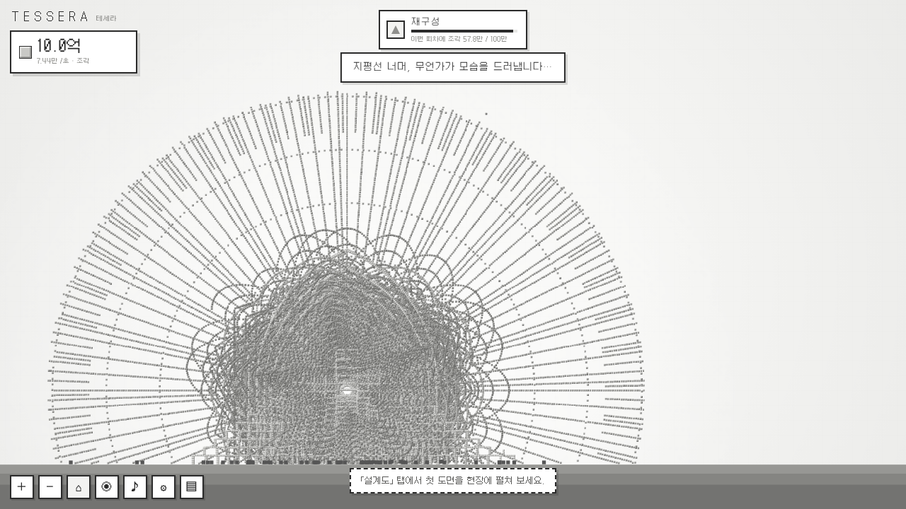
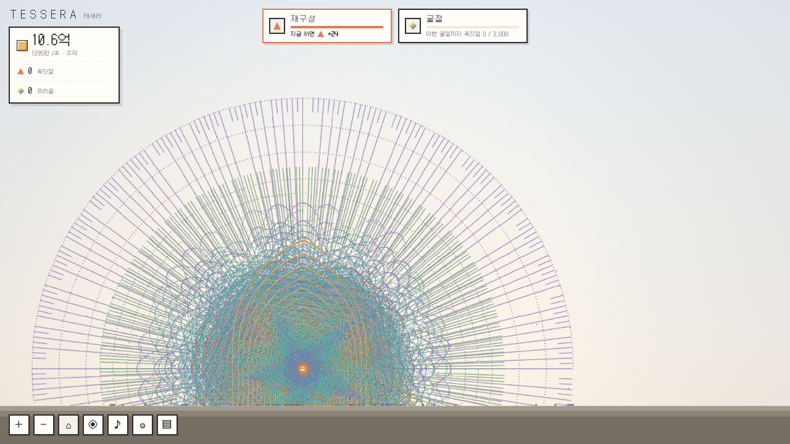

<div align="center">


# TESSERA · 테세라

**작은 건축가들**

네모난 세계, 작은 건축가들이 쌓아 올리는 기하학의 성소.<br>
브라우저에서 바로 즐기는 미니멀 픽셀 인크리멘탈 게임.

### [▶ 데모 플레이하기](https://rednebula100.github.io/TESSERA/)

[](https://github.com/rednebula100/TESSERA/actions/workflows/pages.yml)


</div>

---

<p align="center"></p>

흰 하늘과 회색 땅뿐인 고요한 2D 격자 세계입니다. 화폐 **조각**으로 작고 귀여운 네모 **건축가**를 고용하면, 건축가는 5초마다 블럭을 하나씩 던져 올립니다.
건축가마다 자기만의 기하학 패턴이 있어서, 여럿이 모이고 블럭이 수십만 개 쌓이면 거대한 장미창 같은 구조물이 떠오릅니다.
리셋을 거듭하면 세모·동그라미·오각·별·육각 건축가가 합류하고, 두 번째 리셋 순간 **세상에 처음으로 색이 생깁니다.**

## 스크린샷

| 처음, 고요한 회색 세계 | 설계도 — 드래프팅 테이블 |
|---|---|
|  |  |
| **수십만 블럭의 기하학 (색 이전)** | **굴절 이후, 색이 생긴 세계** |
|  |  |

## 특징

- **귀여운 네모 건축가**: 깜빡이고, 쓰다듬으면 하트를 뿜고, 들어 올리면 버둥거리고, 높이서 떨어지면 빙글빙글 어지러워합니다. 레벨이 오르면 리본, 안전모, 왕관을 씁니다.
- **기하학 패턴**: 모든 건축가는 공통 중심을 공유합니다. 같은 모양 건축가가 늘어날 때마다 회전 각이 1/2, 1/4, 3/4… 로 나뉘어서, 무늬가 점점 촘촘하지만 언제나 규칙적인 장미창으로 자랍니다.
- **설계도**: 오벨리스크부터 대성당까지 10종입니다. 손그림 도면 시트, 치수선, 표제란이 있고, 완공하면 스캔라인·도장·명판 연출과 함께 영구 '명성'을 얻습니다.
- **세 겹의 리셋 레이어**
  - **재구성 → 꼭짓점**: 새 공간 '꼭짓점 공방'과 새 건축가
  - **굴절 → 프리즘**: 회색 세계에 **색이 탄생하는** 연출
  - **물들임 → 안료**: 채색 펫 **방울**이 등장하고, 색 설계도(팔레트)를 따라 중심에서 바깥으로 칠합니다.
- **관측 모드 (H)**: UI를 걷어내고 구조물 전체를 감상합니다.
- **음악 상자 같은 세계**: 블럭이 착지할 때 높이에 따라 5음계가 작게 울립니다.
- 오프라인 진행(최대 8시간), 자동 저장, 저장 코드 내보내기/가져오기.

## 조작

| 입력 | 동작 |
|---|---|
| 하늘 클릭 | 블럭 설치 (설계도 칸 위라면 그 칸을 채움) |
| 빈 곳 드래그 | 맵 이동 |
| 휠 · 핀치 · `+` `−` | 확대 / 축소 |
| 건축가 클릭 | 쓰다듬기 + 정보 카드(레벨업) |
| 건축가 드래그 | 들어 올리기 |
| `H` | 관측 모드 |
| `Esc` | 설계도 배치 취소 · 창 닫기 |

## 로컬에서 실행

빌드 단계가 없습니다. 아무 정적 서버로 열면 됩니다.

```bash
git clone https://github.com/rednebula100/TESSERA.git
cd TESSERA
python3 -m http.server 8000
# http://localhost:8000
```

### 감상·디버그용 URL

데모 모드에서는 저장 데이터를 읽지도, 덮어쓰지도 않습니다.

| URL | 내용 |
|---|---|
| `?demo=60` | 건축가 60명이 블럭을 쌓아 둔 회색 세계 |
| `?demo=120&blocks=4000&color` | 색 이후 후반부 대형 구조물 |
| `?demo=24&blocks=400&color&paint` | 방울이 칠하는 중인 세계 |

예: <https://rednebula100.github.io/TESSERA/?demo=120&blocks=4000&color>

## 확정된 설계

| 항목 | 결정 |
|---|---|
| 제목 | **TESSERA · 테세라 — 작은 건축가들** (테세라 = 모자이크를 이루는 작은 네모 조각) |
| 기본 화폐 | 조각 |
| 1차 리셋 | 재구성 → 꼭짓점 |
| 2차 리셋 | 굴절 → 프리즘 (색의 탄생) |
| 3차 리셋 | 물들임 → 안료 (채색 펫 방울) |
| 건축가 순서 | 네모 → 세모 → 동그라미 → 오각 → 별 → 육각 |
| 폰트 | Galmuri (Galmuri11 / 14 / 9 / Mono11) |
| 경제 | 지수 비용 + 제곱근 리셋 획득 → 폭발 없는 완만한 가속 |

전체 설계와 공식은 [`SPEC.md`](SPEC.md)에 있습니다.

## 로드맵 / 남은 결정

- [ ] **밸런스 플레이테스트**: 각 리셋 레이어 도달 시간 측정 후 `js/data.js` 수치 조정
- [ ] **4차 리셋 '공명'**: 구조물을 악보로 읽는 레이어, 새 펫 '울림', 화폐 음표 (설계만 완료, SPEC §9)
- [ ] **별자리 지도**: 완공한 랜드마크를 빛줄기로 잇는 영구 효과 (설계만 완료)
- [ ] 칠각·팔각 등 '다각형' 계열 추가 건축가
- [ ] 모바일 레이아웃 다듬기 (현재는 기본 대응만)
- [ ] 영어 번역

## 프로젝트 구조

```
index.html          진입점
css/style.css       UI (색 이전은 무채색, body.color 이후 파스텔)
js/
  util.js           숫자 포맷(만·억·조…), RNG, 이징
  data.js           건축가·업그레이드·설계도·팔레트 데이터 ← 밸런스 조정은 여기
  patterns.js       결정론적 기하 패턴
  world.js          카메라, 청크 캐시 렌더링, LOD
  sprites.js        절차적 픽셀 스프라이트
  entities.js       건축가·방울 AI, 투척, 상호작용
  blueprints.js     설계도 배치·진행·완공·도면 시트
  game.js           상태, 경제, 리셋, 저장
  fx.js             파티클, 완공·리셋·색의 탄생 연출
  audio.js          블럭 음계 + 효과음
  ui.js             HUD, 패널, 모달
  main.js           루프, 입력
vendor/             Galmuri 폰트, Rough.js, ZzFX (오프라인 동작)
docs/               스크린샷, 파비콘, OG 이미지
```

블럭 좌표는 저장하지 않습니다. 건축가별 블럭 개수만 저장하고 패턴으로 다시 생성하므로, 수십만 블럭도 저장 용량이 작습니다.

## 크레딧 & 라이선스

- 코드: [MIT](LICENSE) © 2026 Red Nebula
- [Galmuri](https://github.com/quiple/galmuri) by Quiple: SIL Open Font License 1.1 ([`vendor/fonts/OFL-Galmuri.md`](vendor/fonts/OFL-Galmuri.md))
- [Rough.js](https://github.com/rough-stuff/rough) by Preet Shihn: MIT ([`vendor/LICENSE-roughjs`](vendor/LICENSE-roughjs))
- [ZzFX](https://github.com/KilledByAPixel/ZzFX) by Frank Force: MIT ([`vendor/LICENSE-zzfx`](vendor/LICENSE-zzfx))

---

<sub>**English** · TESSERA is a minimalist pixel-art incremental game about tiny square architects who toss blocks into geometric rose windows. A gray world gains color at the second prestige. Korean UI. Play in the browser: <https://rednebula100.github.io/TESSERA/></sub>
