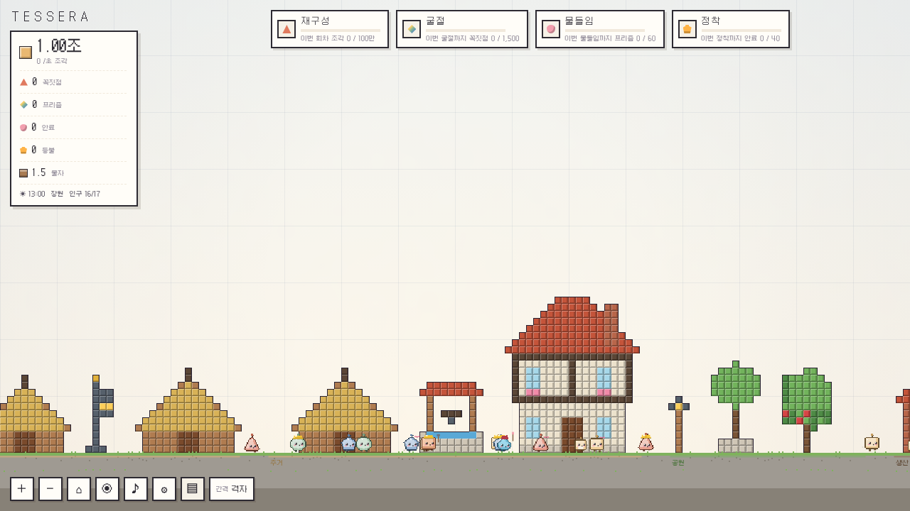
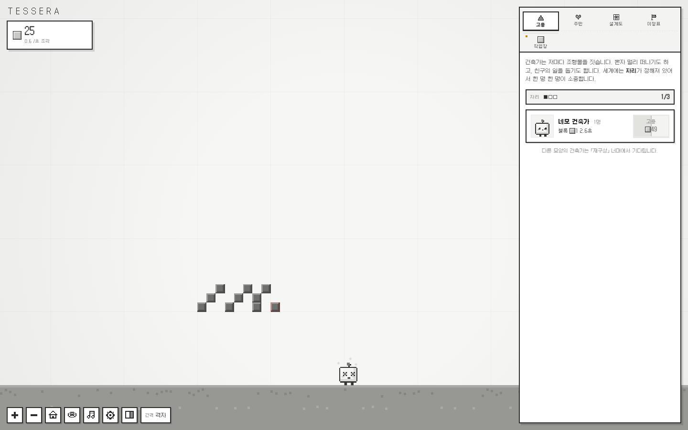
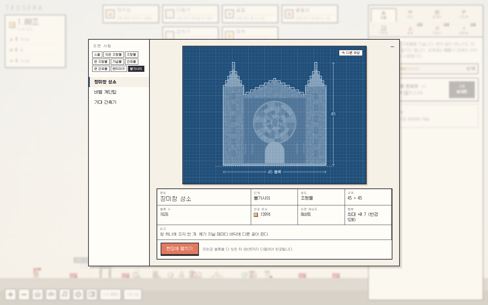
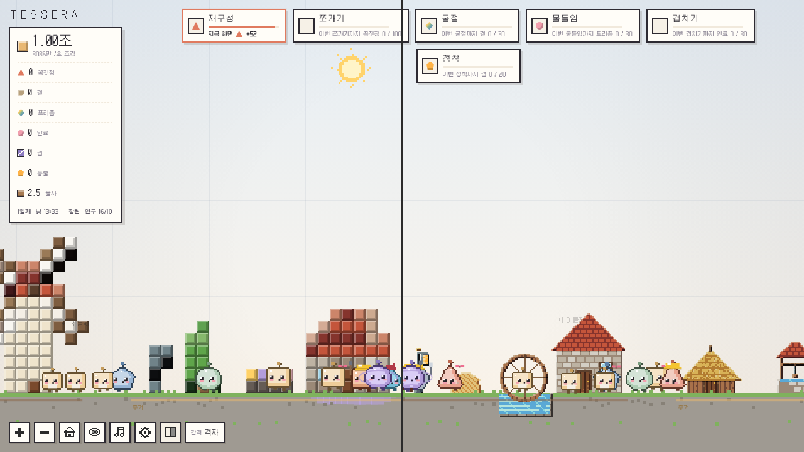
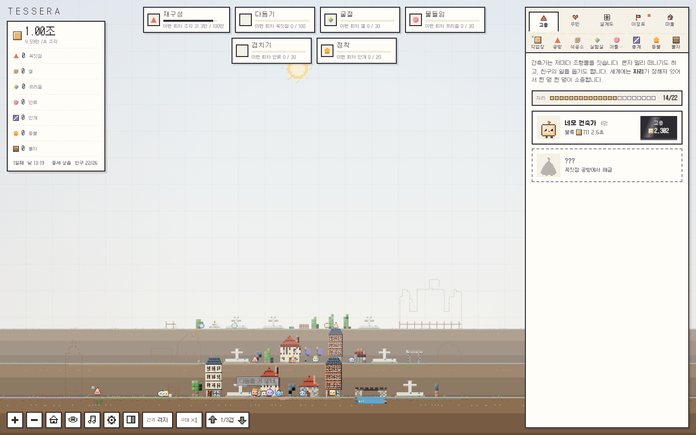
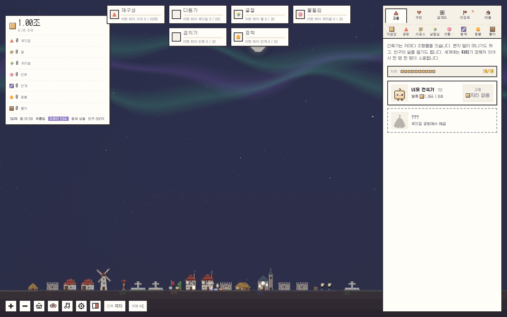
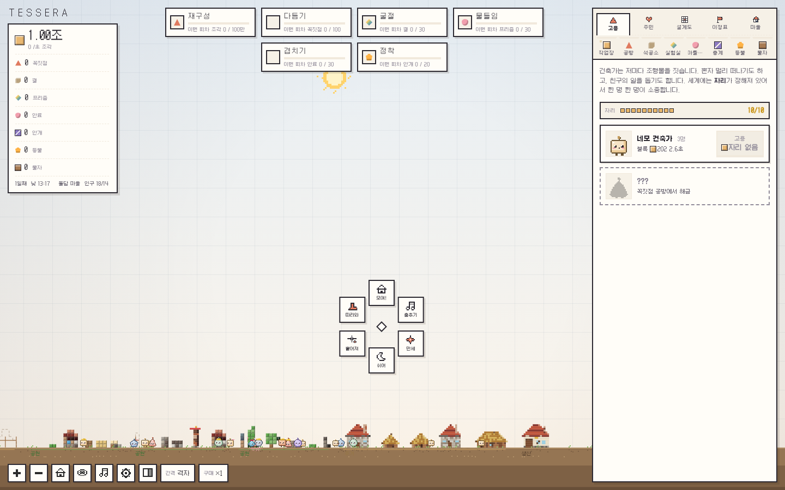
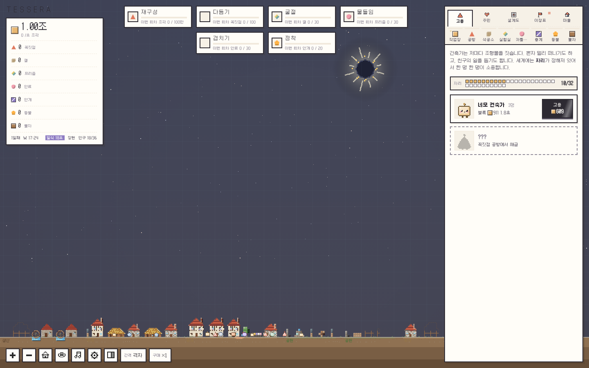
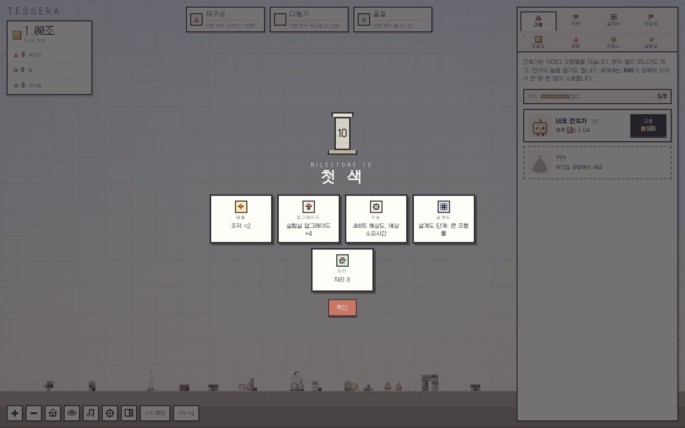

<div align="center">


# TESSERA

**작은 건축가들**

네모난 세계, 작은 건축가들이 쌓아 올리는 기하학의 성소.<br>
브라우저에서 바로 즐기는 미니멀 픽셀 인크리멘탈 게임.

### [▶ 데모 플레이하기](https://rednebula100.github.io/TESSERA/)

[](https://github.com/rednebula100/TESSERA/actions/workflows/pages.yml)


</div>

---

<p align="center"></p>

흰 하늘과 회색 땅뿐인 고요한 2D 격자 세계입니다. 화폐 **조각**으로 작고 귀여운 네모 **건축가**를 고용하면, 건축가들은 블록을 하나씩 던져 올려 조형물을 짓습니다. 혼자 멀리 떠나 짓기도 하고, 친구와 함께 짓기도 합니다.
처음 지은 건축물은 투박한 블록 덩어리입니다. **다듬기**로 블록을 1비트에서 8비트까지 곱게 다듬으면 건축물의 진짜 모습이 드러나고, **굴절**로 세상에 색이 생기면 **방울**이 다듬어진 칸을 하나하나 칠합니다. **겹치기**로 세상 뒤에 세상이 겹치고, **정착**하면 집을 짓고 잠을 자고 아기가 태어나는 마을이 시작됩니다.

## 스크린샷

| 처음, 고요한 회색 세계 | 불가사의 「장미창 성소」 도면 |
|---|---|
|  |  |
| **다듬기 전(왼쪽)과 8비트로 다듬은 뒤(오른쪽)** | **세 겹의 중세 성읍** |
|  |  |
| **오로라가 뜬 밤** | **부탁 메뉴** |
|  |  |
| **달이 해를 가린 일식** | **이정표 보상 카드** |
|  |  |

## 특징

- **귀여운 건축가들**: 쓰다듬으면 하트를 뿜고, 들어 올리면 버둥거리고, 짓고 있는 곳 근처에 내려놓으면 거듭니다. 세계에는 **자리**가 정해져 있어서 한 명 한 명이 소중합니다.
- **9단계 픽셀 건축물 70종**: 재질별 색조 이동 램프, 질감, 자동 외곽선과 명암으로 그린 절차적 픽셀 아트.
  - 단계는 크기로 정해서 소품부터 **불가사의**(장미창 성소, 바벨 계단탑, 거대 건축가)까지 단계마다 확실히 커집니다.
- **다듬기와 도면 해상도**: 톡톡 주민이 블록을 결대로 다듬습니다. 1비트(1×1)부터 8비트(8×8)까지 있고, 도면 해상도까지 다듬어야 완공됩니다.
  - 다듬고 칠할수록 **완성도**가 올라 주민이 더 행복해집니다.
- **함께 짓기**: 짓고 있는 건축물의 빈칸을 클릭하면 그 칸을 직접 채웁니다.
- **이정표 22개**: 어떤 리셋에도 지워지지 않는 별도 레이어입니다. 세우면 보상 카드가 한 장씩 펼쳐집니다.
- **여섯 겹의 리셋 레이어**: 리셋마다 고유한 연출이 있습니다.
  - 재구성(꼭짓점)
  - 다듬기(결)
  - 굴절(프리즘, 색의 탄생)
  - 물들임(안료, 방울)
  - 겹치기(안개, 겹과 폴짝 주민)
  - 정착(등불, 마을)
- **겹 이동**: 세상 뒤의 겹을 Q / E로 오가며 짓습니다.
- **마을의 삶**: 집과 잠, 수명, 이별과 작은 무덤, 행복 범위, 방문, 구역(바꾸면 알아서 다시 지음), 아기와 일꾼, 「모여」 다음 「흩어져」의 밤샘.
- **하늘**: 날짜와 시간, 위상이 바뀌는 달, 별과 별똥별. 가끔 **오로라**가 뜨거나 달이 해를 가리는 **일식**이 찾아옵니다.
- **연대기**: 움집 마을, 돌담 마을, 장원, 중세 성읍. 넘어갈 때 연대기 책장이 넘어갑니다.
- **소리**: Kenney와 uisfx의 CC0 효과음 54개를 게임 톤에 맞게 골라 다듬었습니다. 블록은 높이에 따라 5음계로 노래합니다.
- **밸런스**: 같은 상점의 배율은 더하기형, 보유 보너스는 로그, 리셋 획득은 점점 가팔라지는 곡선입니다.
  - 상한 계산기(`tools/balance.js`)가 실제 공식으로 폭주를 검사하고, CI에서 실패를 막습니다.
- **편의**: 안내서, 고유 픽셀 툴팁과 스크롤바, 구매 수량(×1~최대), 일괄 레벨업 목표 칩, 개발자 모드(코드 `DEV`).

## 조작

| 입력 | 동작 |
|---|---|
| 좌클릭 | 블록 설치 (쿨타임, 쿨타임 중 클릭은 예약됨) |
| 좌클릭 끌기 | 블록 칠하기 |
| 짓고 있는 건축물의 빈칸 클릭 | 그 칸 채우기 |
| 완공된 건축물 클릭 | 상세 정보와 행복 범위 |
| 간격 버튼 위에서 휠, `[` `]` | 블록 간격 (자유, 격자, 2칸 이상) |
| 우클릭 끌기 | 맵 이동 |
| 우클릭 | 부탁 메뉴 |
| 휠, 핀치, `+` `−` | 확대 / 축소 |
| 주민 클릭 / 끌기 | 쓰다듬기와 정보 카드 / 들어 올리기 |
| 구매 버튼 꾹 누르기 | 점점 빨라지는 연속 구매 |
| 구매 버튼(dock) 클릭, 휠 | 구매 수량 ×1, ×5, ×10, ×25, 최대 |
| `Q` `E`, `PageUp` `PageDown` | 겹 이동 |
| `H` | 관측 모드 |
| `Esc` | 취소, 창 닫기 |

## 로컬에서 실행

빌드 단계가 없습니다. 아무 정적 서버로 열면 됩니다.

```bash
git clone https://github.com/rednebula100/TESSERA.git
cd TESSERA
python3 -m http.server 8000
# http://localhost:8000
```

### 감상과 디버그용 URL

데모 모드에서는 저장 데이터를 읽지도, 덮어쓰지도 않습니다.

| URL | 내용 |
|---|---|
| `?demo=wild` | 정착 전, 블록 그대로의 조형물 |
| `?demo=wild&res=3&color&paint&ms=16` | 8비트로 다듬고 칠한 조형물, 불가사의 도면 |
| `?demo=village&era=3&paint` | 방울이 칠한 장원 시대 마을 |
| `?demo=village&era=4&paint&layers=3` | 세 겹의 중세 성읍 (Q / E로 겹 이동) |
| 아무 URL에 `&dev` | 개발자 탭 (화폐, 진행, 시간 배속, 연출 재생, 사운드 보드) |
| `?demo=village&era=4&clock=160` | 밤의 중세 성읍 |

예: <https://rednebula100.github.io/TESSERA/?demo=village&era=4&paint&layers=3>

## 확정된 설계

| 항목 | 결정 |
|---|---|
| 제목 | **TESSERA** (부제: 작은 건축가들) |
| 기본 화폐 | 조각 |
| 리셋 레이어 | 1 재구성(꼭짓점), 2 다듬기(결), 3 굴절(프리즘), 4 물들임(안료), 5 겹치기(안개), 6 정착(등불) |
| 별도 레이어 | 이정표 (어떤 리셋에도 남음), 연대기 (정착 후) |
| 주민 | 건축가, 일꾼, 아기, 톡톡(다듬기), 방울(채색), 쿵쿵(철거), 폴짝(겹 건너기) |
| 해상도 | 1비트, 2비트, 4비트, 8비트 (물들임 이후 최대) |
| 폰트 | Galmuri |

전체 설계는 [`SPEC.md`](SPEC.md)에, v4 계획과 근원 분석은 [`docs/PLAN-v4.md`](docs/PLAN-v4.md)에 있습니다.

## 로드맵 / 남은 결정

- [ ] **밸런스 플레이테스트**: 상한 계산기의 이상 플레이 모델은 통과했지만, 실제 플레이로 후반 체감을 확인
- [ ] 연대기 확장: 성곽 도시, 근대, 미래 시대
- [ ] 칠각, 팔각 등 다각형 계열 건축가
- [ ] 모바일 레이아웃 다듬기 (현재는 기본 대응만)
- [ ] 영어 번역

## 프로젝트 구조

```
index.html          진입점
css/style.css       UI (색 이전은 무채색, body.color 이후 파스텔)
audio/              효과음 54개 (CC0) + CREDITS.md
js/
  util.js           숫자 포맷(만, 억, 조), RNG, 이징, 리셋 곡선(taper)
  data.js           건축가, 업그레이드, 이정표, 구역, 안내서 데이터 ← 밸런스 조정은 여기
  patterns.js       기하학 무늬 (비밀 코드)
  pixelart.js       재질 기반 픽셀 아트 엔진 (램프, 질감, 외곽선, 해상도별 색)
  catalog.js        건축물 도감과 9단계 등급 (원시 조형물부터 불가사의, 중세 성까지)
  icons.js          픽셀 아이콘
  uikit.js          고유 툴팁, 픽셀 스크롤바
  world.js          카메라, 겹, 청크 캐시, 하늘(해, 달, 별, 일식), 바닥
  sprites.js        절차적 픽셀 스프라이트
  audio.js          효과음 엔진 (버스, 덕킹, 음계)
  game.js           상태, 경제, 자리, 리셋, 저장(v3 자동 이전)
  structures.js     건축물 배치, 골조와 완공, 다듬기, 채색, 철거, 도면 시트
  village.js        부지와 구역, 낮과 밤, 하늘 이벤트, 행복, 수명, 가족
  entities.js       건축가, 일꾼, 아기, 톡톡, 방울, 쿵쿵, 폴짝
  fx.js             파티클, UI 파티클, 완공, 포털, 색의 탄생, 첫 정착, 크레딧
  fxseq.js          리셋 6종, 시대 전환, 이정표 연출
  ui.js             HUD, 탭, 패널, 모달, 카드, 안내서
  dev.js            개발자 모드
  main.js           루프, 입력, 겹 이동
tools/
  balance.js        밸런스 상한 계산기 (CI)
  check.js          콘텐츠 검사: 단계와 크기, 이정표 보상, 금지어 (CI)
vendor/             Galmuri 폰트, Rough.js, ZzFX (오프라인 동작)
docs/               스크린샷, 파비콘, OG 이미지, PLAN-v4.md
```

건축물은 종류와 시드, 위치, 진행도만 저장하고 도면은 다시 생성하므로 마을이 커져도 저장 용량이 작습니다.

## 크레딧 & 라이선스

- 기획, 디자인, 개발: Red Nebula (게임 안 크레딧에서 볼 수 있습니다)
- 코드: [MIT](LICENSE) © 2026 Red Nebula
- [Galmuri](https://github.com/quiple/galmuri) by Quiple: SIL Open Font License 1.1 ([`vendor/fonts/OFL-Galmuri.md`](vendor/fonts/OFL-Galmuri.md))
- [Rough.js](https://github.com/rough-stuff/rough) by Preet Shihn: MIT ([`vendor/LICENSE-roughjs`](vendor/LICENSE-roughjs))
- [ZzFX](https://github.com/KilledByAPixel/ZzFX) by Frank Force: MIT ([`vendor/LICENSE-zzfx`](vendor/LICENSE-zzfx))
- 효과음: [Kenney](https://kenney.nl), [UI SFX](https://uisfx.com): CC0 1.0 ([`audio/CREDITS.md`](audio/CREDITS.md))

---

<sub>**English**: TESSERA is a minimalist pixel-art incremental game about tiny square architects who build sculptures, settle a village and carry it through the ages up to a medieval town. A gray world gains color at the second prestige. Korean UI. Play in the browser: <https://rednebula100.github.io/TESSERA/></sub>
