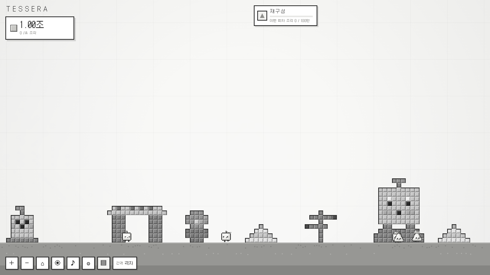

<div align="center">


# TESSERA

**작은 건축가들**

네모난 세계, 작은 건축가들이 쌓아 올리는 기하학의 성소.<br>
브라우저에서 바로 즐기는 미니멀 픽셀 인크리멘탈 게임.

### [▶ 데모 플레이하기](https://rednebula100.github.io/TESSERA/)

[](https://github.com/rednebula100/TESSERA/actions/workflows/pages.yml)


</div>

---

<p align="center"></p>

흰 하늘과 회색 땅뿐인 고요한 2D 격자 세계입니다. 화폐 **조각**으로 작고 귀여운 네모 **건축가**를 고용하면, 건축가들은 블럭을 하나씩 던져 올려 조형물을 짓습니다. 혼자 멀리 떠나 짓기도 하고, 친구와 함께 짓기도 합니다.
리셋을 거듭하면 세모, 동그라미, 오각, 별, 육각 건축가가 합류하고, 두 번째 리셋 순간 **세상에 처음으로 색이 생깁니다.**
네 번째 리셋 **정착**부터는 집을 짓고, 잠을 자고, 아기가 태어나는 **마을**이 시작되고, 연대기를 따라 움집 마을에서 중세 성읍까지 시대를 건넙니다.

## 스크린샷

| 처음, 고요한 회색 세계 | 설계도 드래프팅 테이블 |
|---|---|
|  |  |
| **정착 전, 흩어진 조형물** | **방울이 칠한 장원 마을** |
| **밤의 중세 성읍** | **부탁 메뉴** |
|  |  |
|  |  |

## 특징

- **귀여운 건축가들**: 깜빡이고, 쓰다듬으면 하트를 뿜고, 들어 올리면 버둥거립니다. 한 명 한 명이 소중해서 첫 재구성 전까지는 대여섯 명 정도만 함께합니다.
- **혼자, 또는 함께**: 건축가는 혼자 멀리 떠나 조형물을 세우기도 하고, 친구의 일을 돕기도 합니다. 그렇게 쌓인 것들이 풍경이 됩니다.
- **건축물 도감 50여 종**: 소형, 중형, 대형 조형물부터 건축물, 대형 건축물, 랜드마크까지 등급마다 크기가 확실히 다릅니다. 절차적으로 조금씩 다르게 지어집니다.
- **이정표**: 어떤 리셋에도 지워지지 않는 별도의 레이어. 세울 때마다 업그레이드, 리셋 레이어, 기능이 하나씩 열립니다.
- **네 겹의 리셋 레이어**
  - **재구성 → 꼭짓점**: 꼭짓점 공방과 새 모양의 건축가
  - **굴절 → 프리즘**: 회색 세계에 **색이 탄생하는** 연출
  - **물들임 → 안료**: 채색 펫 **방울**이 단조로운 건축물에 진짜 색을 입히고, 걸어 다닌 땅을 물들입니다.
  - **정착 → 등불**: 조형물을 넘어 **마을**이 시작됩니다.
- **마을의 삶**: 집, 잠, 수명, 이별과 작은 무덤, 행복, 방문, 구역, 아기와 일꾼, 낮과 밤.
- **연대기**: 정착 후 열리는 세부 리셋 레이어. 움집 마을, 돌담 마을, 장원, 중세 성읍으로 넘어가며 건축물, 땅, 구역이 바뀝니다. 여러 조건을 동시에 채워야 합니다.
- **물자와 자동화**: 일꾼이 만든 물자로 고용, 레벨업, 업그레이드를 자동화하고, 꼭짓점과 프리즘을 리셋 없이 모읍니다. 리셋 자체는 자동으로 일어나지 않습니다.
- **부탁 메뉴**: 우클릭으로 모여, 춤추기, 만세, 쉬어, 흩어져, 따라와.
- **비밀 코드**: 설정에서 입력. 오래된 기하학 무늬가 어딘가 잠들어 있습니다.

## 조작

| 입력 | 동작 |
|---|---|
| 좌클릭 | 블럭 설치 (쿨타임 있음) |
| 좌클릭 끌기 | 블럭 칠하기 |
| 간격 버튼 위에서 휠, `[` `]` | 블럭 간격 (자유, 격자, 2칸 이상) |
| 우클릭 끌기 | 맵 이동 |
| 우클릭 | 부탁 메뉴 |
| 휠, 핀치, `+` `−` | 확대 / 축소 |
| 건축가 클릭 / 끌기 | 쓰다듬기와 정보 카드 / 들어 올리기 |
| 구매 버튼 꾹 누르기 | 연속 구매 |
| `H` | 관측 모드 |
| `Esc` | 취소, 창 닫기 |

## 로컬에서 실행

빌드 단계가 없습니다. 아무 정적 서버로 열면 됩니다.

```bash
git clone https://github.com/rednebula100/TESSERA.git
cd TESSERA
python3 -m http.server 8000
# http://localhost:8000
```

### 감상과 디버그용 URL

데모 모드에서는 저장 데이터를 읽지도, 덮어쓰지도 않습니다.

| URL | 내용 |
|---|---|
| `?demo=wild` | 정착 전, 조형물이 흩어진 회색 세계 |
| `?demo=village&era=3&paint` | 방울이 칠한 장원 시대 마을 |
| `?demo=village&era=4&clock=185` | 밤의 중세 성읍 |

예: <https://rednebula100.github.io/TESSERA/?demo=village&era=4&paint>

## 확정된 설계

| 항목 | 결정 |
|---|---|
| 제목 | **TESSERA** (부제: 작은 건축가들) (테세라 = 모자이크를 이루는 작은 네모 조각) |
| 기본 화폐 | 조각 |
| 1차 리셋 | 재구성 → 꼭짓점 |
| 2차 리셋 | 굴절 → 프리즘 (색의 탄생) |
| 3차 리셋 | 물들임 → 안료 (채색 펫 방울) |
| 4차 리셋 | 정착 → 등불 (마을, 연대기) |
| 별도 레이어 | 이정표 (어떤 리셋에도 남음) |
| 생산 화폐 | 물자 (일꾼, 자동화) |
| 건축가 순서 | 네모 → 세모 → 동그라미 → 오각 → 별 → 육각 |
| 폰트 | Galmuri (Galmuri11 / 14 / 9 / Mono11) |
| 경제 | 지수 비용 + 제곱근 리셋 획득 → 폭발 없는 완만한 가속 |

전체 설계와 공식은 [`SPEC.md`](SPEC.md)에 있습니다.

## 로드맵 / 남은 결정

- [ ] **밸런스 플레이테스트**: 각 리셋 레이어 도달 시간 측정 후 `js/data.js` 수치 조정
- [ ] 연대기 확장: 성, 근대, 미래 시대
- [ ] 자동화 고급 단계와 일괄 업그레이드
- [ ] 칠각, 팔각 등 다각형 계열 건축가
- [ ] 모바일 레이아웃 다듬기 (현재는 기본 대응만)
- [ ] 영어 번역

## 프로젝트 구조

```
index.html          진입점
css/style.css       UI (색 이전은 무채색, body.color 이후 파스텔)
js/
  util.js           숫자 포맷(만, 억, 조), RNG, 이징
  data.js           건축가, 업그레이드, 이정표, 구역 데이터 ← 밸런스 조정은 여기
  patterns.js       기하학 무늬 (비밀 코드)
  gridgen.js        건축물 도면을 그리는 작은 도구
  catalog.js        건축물 도감 (원시 조형물부터 중세 성까지)
  structures.js     건축물 배치, 진행, 완공, 철거, 도면 시트
  village.js        부지와 구역, 낮과 밤, 행복, 수명, 가족
  world.js          카메라, 청크 캐시 렌더링, LOD
  sprites.js        절차적 픽셀 스프라이트
  entities.js       건축가, 일꾼, 아기, 방울, 망치
  game.js           상태, 경제, 리셋, 저장
  fx.js             파티클, 완공, 리셋, 색의 탄생, 정착, 시대 전환, 크레딧 연출
  audio.js          블럭 음계 + 효과음
  ui.js             HUD, 패널, 모달
  main.js           루프, 입력
vendor/             Galmuri 폰트, Rough.js, ZzFX (오프라인 동작)
docs/               스크린샷, 파비콘, OG 이미지
```

건축물은 종류와 시드, 위치, 진행도만 저장하고 도면은 다시 생성하므로 마을이 커져도 저장 용량이 작습니다.

## 크레딧 & 라이선스

- 기획, 디자인, 개발: Red Nebula (게임 안 크레딧에서 볼 수 있습니다)
- 코드: [MIT](LICENSE) © 2026 Red Nebula
- [Galmuri](https://github.com/quiple/galmuri) by Quiple: SIL Open Font License 1.1 ([`vendor/fonts/OFL-Galmuri.md`](vendor/fonts/OFL-Galmuri.md))
- [Rough.js](https://github.com/rough-stuff/rough) by Preet Shihn: MIT ([`vendor/LICENSE-roughjs`](vendor/LICENSE-roughjs))
- [ZzFX](https://github.com/KilledByAPixel/ZzFX) by Frank Force: MIT ([`vendor/LICENSE-zzfx`](vendor/LICENSE-zzfx))

---

<sub>**English**: TESSERA is a minimalist pixel-art incremental game about tiny square architects who build sculptures, settle a village and carry it through the ages up to a medieval town. A gray world gains color at the second prestige. Korean UI. Play in the browser: <https://rednebula100.github.io/TESSERA/></sub>
